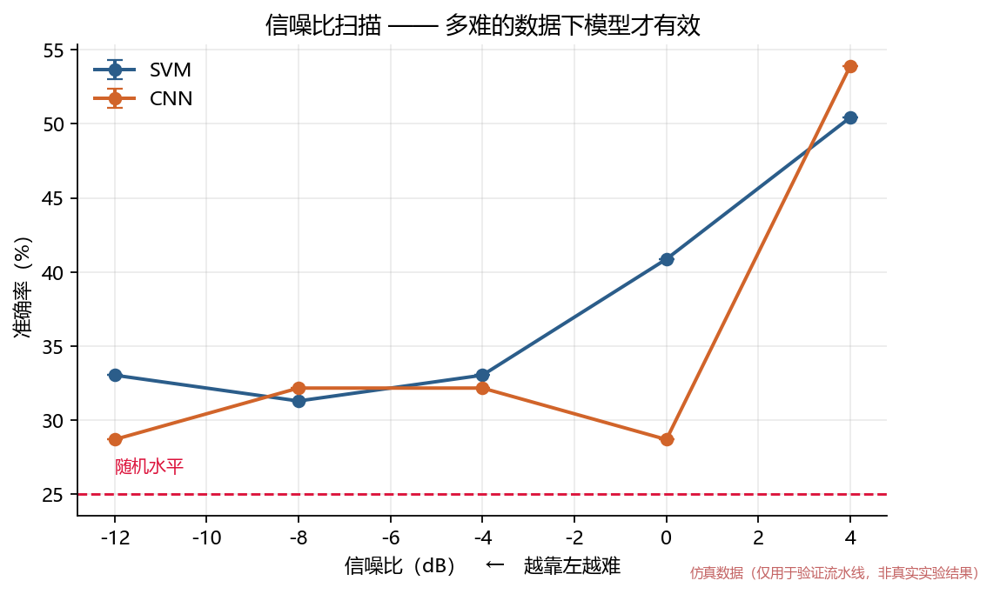
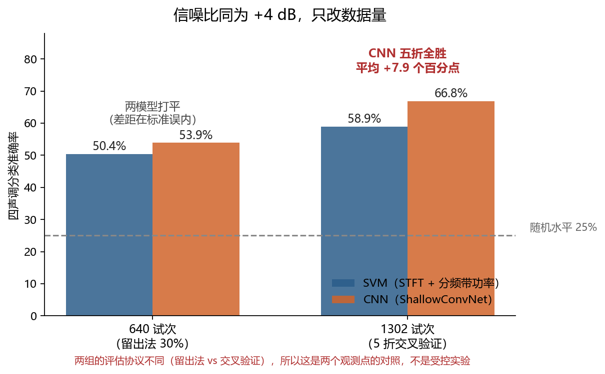

# 汉语脑电信号分类软件系统 —— 技术文档

**项目**：基于深度学习的汉语脑电信号建模与分析研究
**单位**：北京交通大学 · 大学生创新训练计划
**文档版本**：v1.0

---

## 目录

1. [项目背景与交付目标](#一项目背景与交付目标)
2. [系统总体设计](#二系统总体设计)
3. [数据层](#三数据层)
4. [预处理](#四预处理)
5. [特征提取](#五特征提取)
6. [分类模型](#六分类模型)
7. [训练与评估方法学](#七训练与评估方法学)
8. [实验结果与分析](#八实验结果与分析)
9. [软件工程实现](#九软件工程实现)
10. [已知局限与下一步](#十已知局限与下一步)
11. [参考文献](#十一参考文献)

---

## 一、项目背景与交付目标

### 1.1 研究背景

汉语作为声调语言，其语音加工在时间进程与神经空间分布上与英语等非声调语言存在差异。
脑电（EEG）具有毫秒级时间分辨率，是研究语音加工时间进程的合适手段。近年来深度学习
在脑电解码上取得进展（Lawhern et al., 2018; Schirrmeister et al., 2017），但其相对
传统方法的实际优势，尤其在**数据量有限**的脑电研究中，仍缺乏一致结论。

本项目的研究目标是：**在汉语脑电数据上，系统比较深度学习模型与传统特征工程方法的
分类性能，并明确各自的适用条件。**

### 1.2 交付目标

立项报告承诺的项目预期成果是"形成一套汉语脑电信号分类软件系统"。本系统即为该成果，
包含：

| 交付物 | 说明 |
|---|---|
| 软件本体 | Python + PyTorch 实现的完整分类流水线，含图形界面与命令行两种入口 |
| 技术文档 | 本文档，含系统设计与实验设计与结果分析 |
| 使用说明 | [`使用说明.md`](使用说明.md) |
| 答辩材料 | [`答辩材料/`](答辩材料/)，含架构图、结果图、讲稿大纲 |
| 一键运行 | `run.bat`（图形界面）/ `run_cli.bat`（完整流水线） |

### 1.3 数据现状（重要）

**实验室的真实脑电采集尚未开始。** 因此本系统采取"仿真数据 + 真实数据适配器"的策略：

- **软件流水线、模型对比方法、评估指标体系**先在可控的仿真数据上完整验证；
- **真实数据适配器**（EGI `.mff`、BrainVision、EDF/BDF、EEGLAB 等）同步开发完成，
  真实数据到位后改一行配置即可切换，软件本身不需要重写。

> **诚实性声明**
>
> 本系统中所有基于仿真数据的实验结果，只能证明**软件流水线是通的、模型能学到东西、
> 评估方法没有数据泄漏**。仿真数据的类别差异是按先验人为写进模板的，模型学到它们
> 是理所当然的 —— **这不是科学发现**。
>
> 因此：所有图表右下角带"仿真数据"水印；HTML 报告顶部显示红色警示横幅（真实数据
> 显示绿色标记）；终端输出与数据摘要中均显式标注。真实数据接入后重新运行，
> 届时结论才具科学意义。

---

## 二、系统总体设计

### 2.1 分层架构

系统采用**数据 → 预处理 → 特征/模型 → 评估 → 呈现**的分层结构，层与层之间通过
数据类（`EEGDataset`、`EvaluationResult`）传递，界面与命令行共用同一套后端：

```
┌─────────────────────────────────────────────────────────────┐
│  呈现层                                                       │
│   ┌───────────────────────┐   ┌───────────────────────────┐ │
│   │  PyQt5 图形界面        │   │  命令行 CLI                │ │
│   │  ① 数据 ② 预处理       │   │  gen-data / train /       │ │
│   │  ③ 训练 ④ 评估 ⑤ 推理  │   │  compare / sweep /        │ │
│   └───────────┬───────────┘   │  report / infer / gui     │ │
│               │               └─────────────┬─────────────┘ │
└───────────────┼─────────────────────────────┼───────────────┘
                │                             │
┌───────────────▼─────────────────────────────▼───────────────┐
│  应用层                                                       │
│   train.py（交叉验证 / 置换检验 / 指标）                       │
│   report.py（HTML 报告）      plots.py（全部图表）             │
└───────────────┬─────────────────────────────────────────────┘
                │
┌───────────────▼─────────────────────────────────────────────┐
│  模型层                                                       │
│   models.py：SVMClassifier（sklearn Pipeline）                │
│              CNNClassifier（PyTorch ShallowConvNet）          │
│   features.py：STFT 时频特征 + 分频带功率特征                  │
└───────────────┬─────────────────────────────────────────────┘
                │
┌───────────────▼─────────────────────────────────────────────┐
│  数据层                                                       │
│   data/synthetic.py  仿真脑电生成器（8 通道/32 通道、多受试者）│
│   data/loaders.py    真实数据适配器（MNE）+ PsychoPy 日志对齐  │
│   data/epoching.py   滤波/重参考/基线/伪迹剔除/标准化          │
│   data/base.py       EEGDataset 数据容器 + 电极坐标            │
└───────────────┬─────────────────────────────────────────────┘
                │
┌───────────────▼─────────────────────────────────────────────┐
│  config.py：YAML 配置加载、点号路径覆盖、跨字段一致性校验      │
└─────────────────────────────────────────────────────────────┘
```

### 2.2 数据流

```
                 configs/default.yaml
                          │
        ┌─────────────────┴─────────────────┐
        │                                   │
   data.source = synthetic           data.source = file
        │                                   │
  synthetic.py 生成                    loaders.py 读取
  (32 导 × 256 Hz × 多受试者)          (.mff/.vhdr/.edf/...)
        │                                   │
        └─────────────────┬─────────────────┘
                          ▼
              epoching.py 预处理
        滤波 → 陷波 → 重参考 → 切分 → 基线 → 剔除伪迹 → 标准化
                          ▼
                   EEGDataset (n_trials, n_ch, n_times)
                          │
        ┌─────────────────┴─────────────────┐
        ▼                                   ▼
  features.py                        原始试次数据
  STFT + 分频带功率                        │
        │                                   │
        ▼                                   ▼
   SVMClassifier                     CNNClassifier
   (StandardScaler → PCA? → SVC)     (ShallowConvNet)
        │                                   │
        └─────────────────┬─────────────────┘
                          ▼
                  train.py 交叉验证
       分层 K 折 / 留一受试者 / 置换检验
                          ▼
                  EvaluationResult
                          │
        ┌─────────────────┼─────────────────┐
        ▼                 ▼                 ▼
   plots.py          report.py         GUI 界面
   全部图表          HTML 报告          结果展示
```

### 2.3 模块清单

| 文件 | 职责 | 行数 |
|---|---|---|
| `src/cneeg/config.py` | 配置加载、点号覆盖、跨字段校验 | 378 |
| `src/cneeg/data/base.py` | `EEGDataset` 容器、内容指纹、32 导电极坐标 | 266 |
| `src/cneeg/data/synthetic.py` | 仿真脑电生成器 | 520 |
| `src/cneeg/data/loaders.py` | MNE 适配器、PsychoPy 日志对齐 | 428 |
| `src/cneeg/data/epoching.py` | 预处理链 | 371 |
| `src/cneeg/features.py` | STFT 时频特征、分频带功率 | 188 |
| `src/cneeg/models.py` | SVM 基线、ShallowConvNet | 390 |
| `src/cneeg/train.py` | 交叉验证、置换检验、逐折配对比较、评估指标 | 647 |
| `src/cneeg/plots.py` | 全部图表 + 中文字体处理 | 497 |
| `src/cneeg/report.py` | HTML 报告生成 | 341 |
| `src/cneeg/cli.py` | 命令行入口（7 个子命令） | 634 |
| `src/cneeg/gui/` | PyQt5 界面（主窗口 + 5 页 + 后台线程） | 1989 |
| **合计** | | **6712** |

> 行数为 `src/cneeg/` 下全部 `.py` 的实测总数（含上表未单列的 `__init__.py` 等小文件）；
> 复现：`find src -name "*.py" | xargs wc -l | tail -1`。

---

## 三、数据层

### 3.1 仿真脑电生成器

真实数据未到位，但软件流水线必须先跑通。仿真数据的作用是**让模型对比有意义** ——
如果用纯随机噪声，两个模型都只能拿到随机水平，对比就毫无信息量。

因此生成器产出的不是噪声，而是**生理上说得通的信号**。

#### 3.1.1 单试次信号模型

```
X[ch, t] = 诱发成分 spatial[ch] × erp[t]     ← 类别间不同，模型要学的东西
         + 1/f 粉红噪声（空间相关）           ← 背景脑活动
         + α(10 Hz) / β(20 Hz) 节律振荡       ← 类别间有功率差异（ERD/ERS）
         + 50 Hz 工频                         ← 中国市电干扰
         + 伪迹（眨眼 / 肌电 / 通道脱落）
```

#### 3.1.2 五个 ERP 成分

各类别的诱发成分由五个标准成分的**幅度组合**决定，潜伏期固定：

| 成分 | 潜伏期 (s) | 宽度 (s) | 功能含义 |
|---|---|---|---|
| P1 | 0.10 | 0.030 | 早期视觉/听觉成分 |
| N170 | 0.17 | 0.035 | 视觉词形区（左侧颞枕） |
| P300 | 0.30 | 0.060 | 注意资源分配 |
| N400 | 0.42 | 0.080 | 语义整合（中央顶区） |
| LPC | 0.62 | 0.120 | 晚期正成分，加工负荷 |

各类别通过给这五个成分**不同的幅度**来区分。例如四声调预设中，上声（ǎ）的
N400 与 LPC 幅度最高（因为上声的调形最复杂、加工负荷最大），而去声（à）的
P300 更突出。

#### 3.1.3 空间拓扑

每个类别指定 2–3 个**皮层热点**及其权重，再对全脑电极做高斯平滑，得到连续的
空间分布场：

$$\text{spatial}[ch] = \sum_{k} w_k \cdot \exp\left(-\frac{\|p_{ch} - h_k\|^2}{2\sigma^2}\right)$$

用平滑场而不是随机投影，是为了让拓扑连续 —— 与真实 ERP 的空间分布形态一致。
各类别热点不同，因此**空间卷积层有东西可学**；各类别 ERP 时间波形不同，
因此**时频特征也有东西可学**。两个模型都有发挥空间，对比才公平。

#### 3.1.4 信噪比定义与标定

$$\text{ERP 峰值幅度} = \text{背景 RMS} \times 10^{\text{snr\_db}/20}$$

其中背景 RMS 由三段噪声功率合成：

$$\text{BACKGROUND\_RMS} = \sqrt{15^2 + 8^2 + 4^2} \approx 17.46 \ \mu V$$

分别对应 1/f 粉红噪声、α/β 节律、工频残余的典型幅度。

**注意**：`snr_to_scale()` 返回的是**绝对幅度（µV）**，不是相对倍数 ——
这是实现时踩过的坑，写成相对倍数会让信噪比随背景噪声变化而失控。

默认 `snr_db: 4.0` 是**实测标定**的结果，标定脚本为 `scripts/calibrate_snr.py`：
把信噪比从 −12 dB 扫到 +4 dB，找出 SVM 与 CNN 都能明显高于随机水平的取值。
标定数据见第 8.1 节。

#### 3.1.5 三个预设

| 预设 | 类别 | 用途 |
|---|---|---|
| `vowel_tone` | 4 类（/a/ 的四声：阴平、阳平、上声、去声） | ★ 核心实验：汉语声调解码 |
| `mandarin_word` | 3 类汉语词汇（妈 / 八 / 搭） | 词汇分类 |
| `english_word` | 3 类英语单词（yes / or / no） | ★ 直接对齐实验室现有 PsychoPy 范式 |

**随机种子固定**，同样配置每次生成的数据完全一致，结果可复现。

### 3.2 真实数据适配器

统一协议：`load() → (data[n_ch, n_t], sfreq, events, event_codes, ch_names)`。

| 格式 | 扩展名 | 典型来源 |
|---|---|---|
| EGI NetStation | `.mff` | 本实验室使用的采集系统 |
| BrainVision | `.vhdr` | BrainProducts |
| EDF / BDF | `.edf` / `.bdf` | 临床与通用设备 |
| EEGLAB | `.set` | MATLAB 生态 |
| FIF | `.fif` | MNE 原生格式 |

按扩展名自动分发到 MNE 对应的读取函数。

**与 PsychoPy 打标日志对齐**：若记录中没有内嵌事件轨，可读 PsychoPy 导出的
试次日志 CSV（含 `word_onset_s`、`marker` 等列），把 `word_onset_s` 换算成
采样点索引作为事件 onset。实验室现有的 `word_reading_eeg.py` 范式打的是
`'YES '` / `'OR  '` / `'NO  '`，`english_word` 预设的类名与之一致。

---

## 四、预处理

处理链按顺序执行，每一步都可配置、可关闭：

| 步骤 | 默认参数 | 作用 | 实现 |
|---|---|---|---|
| 1. 带通滤波 | 0.5 – 40 Hz | 去除慢漂移与高频肌电 | FIR（MNE）或 Butterworth 零相位（SciPy） |
| 2. 工频陷波 | 50 Hz, 带宽 2 Hz | 抑制市电干扰 | IIR 陷波 |
| 3. 时间窗裁剪 | −0.2 – 1.0 s | 截取刺激前后分析窗 | 索引切片 |
| 4. 重参考 | CAR（全脑平均） | 抑制共模噪声 | 逐时间点减去全脑均值 |
| 5. 基线校正 | −0.2 – 0 s | 消除试次间慢漂移 | 减去基线窗均值 |
| 6. 伪迹剔除 | > 150 µV | 丢弃含眨眼/肌电/脱落的试次 | 峰峰值阈值 |
| 7. 标准化 | 逐通道 z-score | 统一各通道量级 | 逐通道去均值除标准差 |

**关于顺序的两个设计考虑**：

1. **时间窗裁剪放在滤波之后**。滤波需要窗口外的数据作为上下文，先裁剪会让
   边界效应提前污染信号。
2. **标准化放在最后**。若先标准化再剔除伪迹，伪迹会拉大标准差，反而把真正的
   信号压小 —— 阈值判定会失准。

预处理产出一个 `PreprocessReport`，记录每一步的实际参数与被剔除的试次数，
在界面、终端与报告中都会显示。**剔除试次数是重要的质量指标** —— 若剔除比例
过高（例如超过 30%），说明阈值设置过严或数据质量有问题。

---

## 五、特征提取

对应立项报告中的"STFT-SVM 基线模型"。

### 5.1 分频带功率（`bandpower`）

用 Welch 法估计功率谱密度，在五个标准频带内取平均：

| 频带 | 范围 |
|---|---|
| δ delta | 1 – 4 Hz |
| θ theta | 4 – 8 Hz |
| α alpha | 8 – 13 Hz |
| β beta | 13 – 30 Hz |
| γ gamma | 30 – 40 Hz |

维度 = 电极数 × 频带数 = 32 × 5 = **160**。能捕获事件相关去同步/同步（ERD/ERS），
但**完全丢失时间信息**。

### 5.2 STFT 时频特征（`stft`，默认）

短时傅里叶变换得到"电极 × 频率 × 时间"的时频功率图，再按频带在**频率轴**上聚合、
**保留时间轴**，最后展平：

```
维度 = 电极 × 频带 × 时间帧 + 分频带功率
```

在默认配置下（nperseg=64，noverlap=48，307 采样点）：

```
时间帧数 = 21
有效频带数 = 4（见下方警告）
32 × 4 × 21 + 32 × 5 = 2688 + 160 = 2848 维
```

这样既能反映节律功率，也能反映诱发成分出现的时间点，比单纯的频带功率信息量大得多。
代价是维度高，通常需要配合 PCA 降维。

> **实现中发现的一个坑（已加警告）**
>
> `nperseg=64` 在 256 Hz 采样率下，STFT 的频率分辨率为 **4 Hz**，最低可用频点
> 就是 4 Hz，正好落在 δ 频带 [1, 4) 之外 —— δ 频带在时频特征里**一个频点都取不到**，
> 会被静默跳过。配置里写了 5 个频带，实际只有 4 个进入时频部分（分频带功率部分
> 仍包含 δ，因为它用 Welch 独立计算）。
>
> 修复方式：`features.py` 现在会在频带被跳过时发出 `RuntimeWarning`，明确告知
> 分辨率、被跳过的频带、以及解决办法（增大 `features.stft_nperseg`）。
> 静默丢特征是很难排查的问题，必须让人看见。

---

## 六、分类模型

### 6.1 SVM 基线

sklearn `Pipeline`，完整流程：

```
FeatureExtractor（STFT 时频特征，2848 维）
    ↓
StandardScaler（逐特征标准化）
    ↓
PCA（可选，pca_components > 0 时启用）
    ↓
SVC(kernel='rbf', C=1.0, gamma='scale', probability=True)
```

**为什么用 RBF 核**：脑电特征与类别标签之间是非线性关系，线性核表现通常明显更差。
`probability=True` 是为了输出置信度供界面显示（代价是内部做 5 折 Platt 校准，
训练时间变长 —— 这也是 SVM 一次交叉验证需要 71 秒的原因之一）。

**PCA 的作用**：2848 维特征里有大量冗余（相邻时间帧、相邻频带高度相关）。
在试次数少于特征维度时（例如 1302 试次 vs 2848 维），PCA 降维能显著改善
SVM 的条件数与泛化能力。默认 `pca_components: 0`（不降维），需要时可开启对比。

### 6.2 ShallowConvNet 深度学习模型

采用 Schirrmeister et al. (2017) 提出的 ShallowConvNet，这是脑电解码领域的
标准基准架构。逐层结构：

```
输入 (batch, 1, n_ch, n_times)
    ↓
Conv2d(1 → 40, kernel=(1, 25), bias=False)    时间卷积：学 25 个采样点（≈100 ms）的时域滤波器
    ↓
BatchNorm2d(40)
    ↓
Conv2d(40 → 40, kernel=(n_ch, 1), bias=False) 空间卷积：跨全部电极做加权，学空间分布
    ↓
BatchNorm2d(40)
    ↓
平方 x²                                        ≈ 瞬时功率（去相位，只留能量）
    ↓
AvgPool2d((1, 75), stride=(1, 15))             时间窗平均 ≈ 频带能量
    ↓
log(clamp(x, min=1e-6))                        对数压缩动态范围
    ↓
Dropout(0.5)
    ↓
Linear(n_flat → n_classes)
```

**几个设计要点：**

- **时间卷积 → 空间卷积的顺序**是 ShallowConvNet 的核心。先在每个电极上独立学
  时域滤波器（相当于学带通），再跨电极做空间加权（相当于学空间滤波/CSP），
  这与传统脑电处理"先滤波再空间滤波"的思路一致，只是滤波器由数据学出来。
- **平方 + 平均池化 + 对数**这三步合起来近似"频带能量"的定义，
  这正是传统方法里手工计算的那个量 —— 网络把它学出来。
- **空间卷积的卷积核覆盖全部电极**（`kernel=(n_ch, 1)`），因此网络能学到
  任意空间分布，不受限于固定的电极对。

**训练配置**：

| 项 | 默认值 | 说明 |
|---|---|---|
| 优化器 | Adam | lr = 0.001 |
| 损失 | 交叉熵（带类别权重） | 类别不均衡时自动加权 |
| 早停 | 验证集**宏 F1**，耐心 25 轮 | 用 F1 而非准确率，避免被多数类主导 |
| 最大轮数 | 120 | 早停通常在 30–60 轮触发 |
| 批大小 | 32 | |
| Dropout | 0.5 | |

**验证集从哪来**：`fit()` 时从训练集内部再切一小块（默认 20%）作为验证集用于早停。
这一小块**来自训练集**，不碰测试折 —— 否则就是数据泄漏。

---

## 七、训练与评估方法学

这一节是本项目的**方法学核心**。模型好坏可以讨论，但评估口径错了，
所有数字都没有意义。

### 7.1 分层 K 折交叉验证（默认）

- 每折的类别比例与总体一致（分层），避免某折恰好缺某个类；
- **每折重新训练一个全新模型**。共用模型会让测试折的信息通过权重泄漏进后续折，
  得到虚高的准确率 —— 这是初学者最常犯的错误；
- 折数上限是**最小类别的试次数**，不是类别数。用类别数当上限会让"4 分类要 5 折"
  被悄悄降成 4 折，用户拿到的划分与配置里写的对不上却毫无提示。

### 7.2 留一受试者交叉验证

按受试者分组（`StratifiedGroupKFold`），**测试折里的受试者在训练时完全没有出现过**。

这是**更严格也更贴近实际部署**的设定。两者之差本身就说明问题：

- 若留一受试者结果接近普通交叉验证 → 模型学到的是**任务相关的通用规律**；
- 若前者明显更低 → 模型很大程度上是在学**个体特征**（每个人的头形、阻抗、
  电极位置差异），换个人就失效。

对脑电研究而言，这个差别至关重要，因为临床与实用场景中模型必须能泛化到新被试。

### 7.3 置换检验（阴性对照）

**这是证明结果可信的关键一步，不能省。**

做法：把标签随机打乱后重跑整个评估流程若干次，得到"没有真实效应时能拿到多好的
结果"的零分布。若真实准确率没有显著高于这个分布，说明模型学到的是数据泄漏或噪声。

实现上，每次置换用**留出法**而不是完整交叉验证 —— 置换次数通常几十次，
再乘上 K 折会让 CNN 跑到天亮。留出法足以说明"效应是否真实存在"。

经验 p 值计算：

$$p = \frac{\#\{s_i \geq s_{\text{obs}}\} + 1}{N + 1}$$

加 1 是标准做法，避免在置换次数有限时得到 p = 0 这种无法解释的值。

> **一个必须讲清楚的统计细节**
>
> 上式意味着 **p 值的理论下限是 1/(N+1)**。只跑 20 次置换时，最小可能 p 值
> 就是 1/21 ≈ 0.048。因此当报告 p = 0.048 时，正确的解读是"20 次置换中
> **没有任何一次**打乱后的结果达到观测值" —— 这是该置换次数下能拿到的最好结果，
> 而不是"勉强压线通过"。
>
> 若需要一个更有说服力的 p 值（例如 p < 0.01），把 `train.n_permutations`
> 调到 200 以上。答辩时若被问到这一点，这是一个能体现方法学素养的回答。

### 7.4 指标选择

| 指标 | 为什么用它 |
|---|---|
| **准确率** | 最直观，但单独看会被多数类主导 |
| **宏平均 F1** | 每类 F1 的算术平均，**类别不均衡时比准确率诚实** |
| **Cohen's κ** | 扣除随机一致性的真实一致性，κ > 0.4 属中等以上 |
| **逐类 P/R/F1** | 只看总准确率会掩盖"某一类完全学不会" |
| **相对随机的提升** | $\frac{\text{acc} - \text{chance}}{1 - \text{chance}}$，归一化后不同任务可比 |
| **混淆矩阵** | 能看出错分模式（例如上声与阳平互相混淆是合理的） |

**随机水平（chance level）怎么算**：取**多数类占比**，不是 $1/\text{类别数}$
（`EEGDataset.chance_level`）。两者在类别均衡时完全相等 —— 所以"四分类随机水平
25%"在均衡数据上并没有说错 —— 但类别一旦不均衡，$1/\text{类别数}$ 会**低估**基线：
一个把所有试次都判成多数类的模型什么都没学到，准确率却等于多数类占比，
在它看来就"高于随机"了。

这不只是理论上的顾虑：**伪迹剔除是按试次独立触发的**，剔完各类别剩下多少并不
相等。本项目的四分类数据剔完剩 1302 试次，四类分别为 326 / 326 / 323 / 327，
多数类占 25.12%，所以软件里显示 **25.1%**，而本文按四舍五入的 **25%** 叙述。
两者是同一个量，不是两个基线。

### 7.5 全量重训模型的使用边界

交叉验证结束后，系统会用**全部数据**重新训练一个模型（`EvaluationResult.full_model`），
供推理页与部署使用。**这个模型见过所有数据，因此绝不能用它汇报性能** —— 那是自欺欺人。

代码中对此有显式注释约束。它唯一正当的用途是：**交叉验证已经证明方法可行之后**，
把全部数据用上，得到一个实际可用的分类器。

---

## 八、实验结果与分析

> 以下全部为**仿真数据**结果。原始记录见 `scripts/acceptance.log`、
> `scripts/compare2.log`、`scripts/snr_sweep.csv`，以及机器可读的
> `data/reports/results_compare_20261007_085113.json`（含逐折指标与置换零分布）。

### 8.1 信噪比标定与扫描

**实验目的**：确定默认信噪比，并回答本项目的核心问题 ——
**多难的数据下，深度模型才跑赢传统方法？**

**实验设置**：4 受试者 × 40 试次/类 × 4 类 = 640 试次，伪迹剔除后约 572 试次，
留出法（测试集 20%，即 `train.test_size` 默认值，实际测试集 115 试次），
四声调分类，随机水平 25%。只改变信噪比，其余条件固定。

| 信噪比 | SVM | CNN | CNN 最佳轮次 | 剔除试次 |
|---:|---:|---:|---:|---:|
| −12 dB | 33.0% | 28.7% | 15 | 67 |
| −8 dB | 31.3% | 32.2% | 8 | 67 |
| −4 dB | 33.0% | 32.2% | 8 | 67 |
| 0 dB | 40.9% | 28.7% | 6 | 68 |
| +4 dB | **50.4%** | **53.9%** | 6 | 69 |



*图 8-1　信噪比扫描。固定其余条件，只改信噪比；阴影为随机水平 25% 附近。
复现命令：`python scripts/calibrate_snr.py` 后 `python scripts/make_slides.py`*

**如何解读（关键）**：

剔完伪迹剩约 572 试次，留出法 20% 意味着测试集只有 **115 个试次**，准确率的标准误约为

$$\text{SE} = \sqrt{\frac{0.25 \times 0.75}{115}} \approx 4.0\% \quad (\text{p} = 0.25), \qquad
\text{SE} = \sqrt{\frac{0.5 \times 0.5}{115}} \approx 4.7\% \quad (\text{p} = 0.5)$$

因此**相差 8 个百分点以内都不应视为有意义的差异**。按这个标准，能站得住的结论只有两条：

1. **信噪比是决定性因素。** 同一对模型，从 −12 dB 到 +4 dB，SVM 从 33.0% 升到 50.4%、
   CNN 从 28.7% 升到 53.9%，即提升 17～25 个百分点；若看**超出随机水平的部分**，
   SVM 从 +8.0 扩到 +25.4 个百分点、CNN 从 +3.7 扩到 +28.9 个百分点，**扩大了三倍以上**。
   讨论"深度学习好不好"而不交代信噪比，是缺乏意义的。
2. **在本任务的仿真数据上，浅层 CNN 并没有稳定超过 STFT-SVM 基线。**
   低信噪比区间（−12 ~ −4 dB）CNN 的准确率在 28.7%–32.2% 之间几乎不随信噪比改善
   而变化，基本停留在随机水平附近；而 SVM 依靠有先验设计的频带功率特征，
   退化得更平缓。只有在信噪比足够高（+4 dB）时才互有胜负，CNN 略优。

这与 Schirrmeister et al. (2017) 的公开结论方向一致 —— 在**数据量有限**时，
深度模型相对传统方法的优势远没有想象中那么大。

> **需要澄清的一点**：文献中常见"低信噪比下深度模型反而更好"的说法，
> 其前提是**数据量足够大**，让 CNN 能自己从噪声里学出合适的滤波器。
> 本实验只有几百到一千余试次，达不到那个前提，因此**没有观测到**该现象。
> 这个"没有显著优势"的结果本身就是一个有价值的结论 —— 它界定了深度学习方法
> 在脑电小样本场景下的适用边界。

### 8.2 主实验：5 折交叉验证

**实验设置**：6 受试者 × 60 试次/类 × 4 类 = 1440 试次，伪迹剔除后 **1302 试次**，
32 导 × 307 采样点，信噪比 +4.0 dB（8.1 节标定所得），四声调分类，
5 折分层交叉验证（每折训练 1041 / 测试 260），随机水平 **25%**。
两种模型跑的是**完全相同的折划分**。

> 随机水平的确切算法是**多数类占比**而不是 1/类别数（见 7.4 节）：伪迹剔除按
> 试次独立触发，剔完各类别剩下的数量并不完全相等，所以软件里实际显示的是
> **25.1%**。四舍五入到 25% 与四类别均衡的直觉一致，本文各处按 25% 叙述；
> 若看到界面显示 25.1%，那是同一个量的更精确写法，不是两个不同的基线。

| 模型 | 准确率 | 宏平均 F1 | Cohen's κ | 特征维度 | 耗时 |
|---|---:|---:|---:|---:|---:|
| SVM（STFT + 分频带功率） | 58.9% ± 1.8% | 0.590 ± 0.017 | 0.452 | 2848 | 89 s |
| CNN（ShallowConvNet） | **66.8% ± 3.0%** | **0.662 ± 0.032** | **0.558** | 原始波形 | 431 s |

原始记录：`scripts/compare2.log`、`data/reports/results_compare_20261007_085113.json`。

CNN 相对随机水平的归一化提升 **+55.7%**，SVM 为 **+45.2%**。

**SVM 的 58.9% ± 1.8% 被独立复现了三次**（三次分别在不同时间、不同机器负载下运行），
逐折准确率逐位相同 —— 种子固定，结果完全可复现。

### 8.3 逐折配对比较：CNN 到底有没有真的超过 SVM

只比"均值 ± 标准差"是**不足以下结论**的：两条流水线跑的是同一批折划分，
误差高度相关，而且均值的标准差里混着"折与折之间难度不同"这个因素。
正确做法是**逐折配对** —— 同一折上两个模型用的是同一份训练/测试数据。

| 折 | SVM | CNN | 差（CNN − SVM） |
|---:|---:|---:|---:|
| 1 | 57.1% | 67.4% | **+10.3%** |
| 2 | 57.5% | 60.9% | **+3.4%** |
| 3 | 61.2% | 68.8% | **+7.7%** |
| 4 | 57.7% | 67.7% | **+10.0%** |
| 5 | 61.2% | 69.2% | **+8.1%** |
| **平均** | **58.9%** | **66.8%** | **+7.9%**（配对标准误 1.2%） |

**CNN 在 5 折中全部胜出**，没有一折例外。这是本节最硬的证据：
它不依赖任何分布假设，也不受"某折特别容易"的影响 ——
因为同一折里两个模型面对的是同一批数据。

> **关于配对 t 检验的诚实说明**：按配对 t 算 t = 6.43（df = 4，双侧 p ≈ 0.003）。
> 但**这个 p 值被高估了**，不应直接引用：交叉验证的各折训练集高度重叠
> （都抽自同一批 1302 试次），导致折间估计量并非独立，标准误被低估。
> 这是 Dietterich (1998)、Nadeau & Bengio (2003) 早已指出的经典问题。
> 所以我们把**"5 折全胜"**作为主要证据，t 值只作为参考列出。

**同时要注意 CNN 的方差不小**：逐折标准差 3.0%，是 SVM（1.8%）的 1.7 倍；
第 2 折只领先 3.4%，而第 1、4 折领先约 10%。也就是说 CNN 平均更好，
但**在不同的数据划分下稳定性不如 SVM** —— 这一点在数据量更小的时候会更明显（见 8.1 节）。

### 8.4 置换检验：证明结果可信

对 SVM 结果做置换检验（20 次打乱标签）：

| 项目 | 数值 |
|---|---|
| 零分布（打乱标签后） | **26.1% ± 3.3%** |
| 实际观测 | **58.9%** |
| 经验 p 值 | **0.048** |

**零分布紧贴随机水平 25%**，这是本实验最重要的可信性证据：

- 打乱标签后模型只能拿到 26.1%，说明**流水线没有数据泄漏** ——
  没有出现"打乱标签还能拿高分"这种典型泄漏症状；
- 观测值 58.9% 高出零分布均值约 10 个标准差，差异极其明显。

p = 0.048 的解读见第 7.3 节 —— 它是 20 次置换下的理论下限，
即"没有一次打乱后达到观测值"。

### 8.5 结论：适用条件在哪里

把 8.1 与 8.2/8.3 放在一起看，才能回答立项报告提出的那个问题 ——
**两种方法各自在什么条件下适用？**

| 条件 | 结论 | 证据 |
|---|---|---|
| 数据量充足（≥1300 试次）、信噪比正常 | **CNN 明显更优**：66.8% vs 58.9%，5 折全胜 | 8.2 / 8.3 |
| 数据量偏小（640 试次）、信噪比正常（+4 dB） | 两者**难分高下**（53.9% vs 50.4%，落在标准误内） | 8.1 |
| 数据量小、信噪比低（−12 ~ −4 dB） | **两者都接近随机**；CNN 退化更快、波动更大 | 8.1 |

**核心发现：决定 CNN 能否发挥优势的不是模型本身，而是数据量。**



*图 8-2　信噪比同为 +4 dB，只改数据量。左（640 试次）两根柱子高度差落在标准误内；
右（1302 试次）CNN 五折全胜。红字图注同样标明了评估协议不同这一局限。
复现命令：`python scripts/make_slides.py`*

注意上表前两行是**同一个信噪比（+4 dB）**下的结果，差别只在数据量：
从 640 试次（每折训练约 457）增至 1302 试次（每折训练 1041），
CNN 的成绩从"与 SVM 打平"跃升到"5 折全胜、平均领先 7.9 个百分点"；
SVM 也从 50.4% 提升到 58.9%，但提升幅度小得多。
**这与"深度模型的优势需要数据量作为前提"这一假设方向一致** ——
而这一次，证据来自我们自己的实验，不是转引文献。

低信噪比那一行则说明另一半：**数据量不足时，CNN 不仅没有优势，还可能更差**。
原因不难理解 —— CNN 要自己从数据里学出滤波器，样本不够时学到的滤波器
不如 SVM 里那套有先验设计的频带功率特征稳健。

> **一个必须说清的局限**：上表的前两行来自**两套不同的实验协议**
> （640 试次/留出法 vs 1302 试次/5 折交叉验证），数据量和评估方式同时变了。
> 因此"数据量是关键"是**对两个观测点的合理解释，不是受控实验的结论**。
> 两个点也画不出趋势。要真正验证它，需要固定其余一切、**只改数据量**做扫描 ——
> 已列入下一步工作（10.2 节）。

其余结论：

1. 本软件流水线**功能完整、可复现**（SVM 结果三次独立复现，逐位相同），
   且经置换检验验证**无数据泄漏**；
2. **信噪比是分类性能的首要决定因素**，其影响远大于模型选择本身 ——
   讨论"深度学习好不好"而不交代信噪比与数据量，是没有意义的；
3. CNN 的**逐折方差（3.0%）明显大于 SVM（1.8%）**：平均更好，但更挑数据划分。

**以上全部基于仿真数据，仅证明方法学有效，不代表真实汉语脑电的性质。**
仿真数据的类别差异是按先验写进模板的，绝对数值偏乐观；不过两种模型面对的是
**完全相同的数据与划分**，所以"谁更好、好多少"这个**相对**比较仍然成立。
真实数据接入后需重新验证。

---

## 九、软件工程实现

### 9.1 图形界面

PyQt5 实现，五个标签页按使用顺序组织。关键实现点：

**后台训练不卡界面**：所有耗时操作在 `QThread` 中执行，通过 Qt 信号回传进度。

```python
class TrainWorker(QThread):
    progress = pyqtSignal(int, int, int, int, float)   # 折, 总折数, 轮, 总轮数, F1
    finished_ok = pyqtSignal(object)
    failed = pyqtSignal(str)
```

信号跨线程传递由 Qt 的事件循环保证线程安全；**界面控件只在主线程被触碰**，
这是 Qt 的硬性要求，违反会导致随机崩溃。

**图表内嵌**：matplotlib 的 `FigureCanvasQTAgg` 嵌入 Qt 布局，训练曲线实时刷新。

**跨页数据流**：主窗口承担协调职责 —— 数据页生成数据后 `broadcast_dataset_changed()`
通知所有页面；训练页完成后 `broadcast_result()` 把结果同时送给评估页（展示）与
推理页（作为可用模型）。页面之间不直接引用，耦合度低。

**单页故障隔离**：某一页构造失败时（例如缺 PyQt5 组件），主窗口用
`_error_page()` 生成一个显示错误信息的替身页面，**其余页面照常可用**，
而不是整个程序启动失败。

**高 DPI 适配**：开启 `AA_EnableHighDpiScaling` 与 `AA_UseHighDpiPixmaps`，
在 150% 缩放的屏幕上不会出现模糊或错位。

> **截图踩坑记录**：用 `QT_QPA_PLATFORM=offscreen` 做无头截图时，
> Windows 上不会加载字体，**中文全部渲染成空白**。正确做法是使用真实的平台插件，
> 配合 `WA_DontShowOnScreen` 属性让窗口不显示但正常渲染。

**截图脚本的两种模式**（`scripts/shoot_gui.py`）：

| 模式 | 命令 | 用途 | 耗时 |
|---|---|---|---|
| 自检 | `python scripts/shoot_gui.py` | 开发时确认界面没坏 | 数秒 |
| 答辩 | `python scripts/shoot_gui.py --populate` | **把界面当真人用一遍**再截图 | 约 1.5 分钟 |

自检模式截出来的是一堆**空画布** —— 界面确实没坏、字体也正常，但里面没有数据。
这种图在答辩现场无法顶替演示，所以正式出图必须用 `--populate`：它会真的生成数据、
真的训练 SVM、真的跑一次推理，于是评估页有混淆矩阵、推理页有空间拓扑图。
加 `--with-cnn` 还会多训一个 CNN，多出一张"模型对比"图（另加数分钟）。

### 9.2 命令行

7 个子命令：`gen-data` / `train` / `compare` / `sweep` / `report` / `infer` / `gui`。
不带子命令时默认打开图形界面（双击 `run.bat` 的体验最顺）。

**`--set 键=值` 覆盖任意配置**，可重复使用，写在子命令前后都行。实现上有两个坑：

1. **argparse 只认子命令之前的全局选项**。直觉上大家会写
   `python -m cneeg gen-data --set ...`，所以 `--config/--set/--file` 被同时挂到了
   每个子解析器上。
2. **子解析器在一个全新的 namespace 上解析**。若两边复用同名 `dest`，
   "子命令前的 `--set`"会被"子命令后的 `--set`"整个覆盖。解决办法是子命令侧存到
   `set_sub`，并在 `main()` 中合并两处结果。

### 9.3 配置系统

`configs/default.yaml` → 嵌套 dataclass，特性：

- **未知键直接报错**，不静默忽略。少写一个字母就白跑一轮训练，静默忽略会让人
  误以为"这个参数没用"；
- **点号路径覆盖**：`--set model.cnn.n_epochs=200`；
- **跨字段一致性校验**：带通上下限写反、时间窗倒置、非法重参考方式等在**启动时**
  就报错。带通写反是典型的静默杀手 —— 滤波器照样返回数组，但结果是垃圾，
  要到准确率等于随机水平时才看得出来。

**刻意没做的一件事**：没有校验低通是否超过奈奎斯特频率。因为采样率对真实数据
来自文件本身、对仿真数据来自配置，配置阶段无从得知最终用哪个 ——
拿仿真采样率去卡真实数据会误伤（1000 Hz 的记录配 100 Hz 低通完全合法）。
这个检查留给真正处理数据的那一步。

### 9.4 测试

`tests/` 下 7 个测试文件，共 **103 个测试函数**：

| 文件 | 测试数 | 覆盖内容 |
|---|---:|---|
| `test_config.py` | 16 | 配置加载、点号覆盖、非法值拦截、落盘往返 |
| `test_synthetic.py` | 11 | 生成器形状/可复现性/信噪比公式/各类别确实可分 |
| `test_preprocess.py` | 21 | 预处理每个步骤的数值正确性、边界情况 |
| `test_dataset_io.py` | 10 | 数据集存读往返、字段不丢、内容指纹、老文件兼容、**随机基线取多数类占比**、**老文件的查重回退** |
| `test_loaders.py` | 13 | PsychoPy 打标日志解析、秒→采样点换算、偏移应用、越界事件 |
| `test_pipeline_smoke.py` | 22 | **端到端**：生成→预处理→特征→训练→交叉验证→评估→画图→报告；含进度事件序列自洽性 |
| `test_launchers.py` | 10 | 一键运行脚本：纯 ASCII、块内括号转义、`%~dp0` 自定位、环境变量 |

> `test_launchers.py` 是**事后补的** —— 见缺陷清单第 15 条。它只做静态检查
> （能不能被 cmd 解析），不做"跑起来是否成功"，因为那要启动 GUI，不适合放进单测。

`test_loaders.py` 用的是实验室 `word_reading_eeg.py` 的真实输出
（`tests/data/trials_sample.csv`，带 UTF-8 BOM），不是手搓的假数据 ——
这样列名、BOM、时间精度都锁死在真实格式上。**事件对齐是整条真实数据链路上
最容易错、错了又看不出来的一步**：偏移量填错时截出来的波形看上去完全正常，
只是锁时点对不上、ERP 被抹平。所以这段换算逻辑被单独抽成了不依赖 MNE 的
``events_from_log_times()``，可以脱离 EEG 文件直接测。

`test_pipeline_smoke.py` 是最重要的一份 —— 单测各自通过、拼起来却崩掉，
是这类项目最典型的事故。它还包含几个**防回归的关键断言**：

- 置换检验后准确率必须落回随机水平附近（防止引入数据泄漏）；
- CNN 在够规模的高信噪比数据上必须明显高于随机（防止生成器或模型被改坏）；
- 交叉验证必须产出 `full_model`（否则推理页拿不到模型）；
- 折数上限必须是**每类试次数**而不是类别数；
- 每个画图函数都必须返回 Figure（崩一个界面就少一张图）；
- HTML 报告必须是自包含的（图片 base64 内嵌），且仿真数据必须带警示标注。

**测试在开发过程中实际抓出的真实缺陷**（不是假警报）：

1. 折数上限用错（类别数 vs 每类试次数）；
2. `full_model` 字段建好了却没传进构造函数，推理页永远拿不到模型；
3. 预处理忽略了配置里的时间窗，界面上的窗口控件静默失效；
4. 界面提供了一个后端并不支持的 `avg` 重参考选项；
5. 配置校验缺失（带通写反、非法重参考不报错）；
6. `plot_waveform` 把 `n_channels` 透传给了 `plt.subplots` 导致绘图崩溃；
7. CNN 的 `val_f1` 被算出来用于早停，却**没有存进历史记录** ——
   界面上的训练曲线只能画准确率，而模型实际优化的是宏 F1，两者对不上；
8. STFT 频率分辨率不足导致 δ 频带被静默丢弃（见第 5.2 节）；
9. **`onset_offset_s` 报了却没做** —— 走 PsychoPy 日志那条路时，偏移量
   既没有加到事件位置上，来源标签里却写着"偏移 +0.000 s"。报了却没做，
   比不报更糟：用户会以为对齐已经处理好了，而实际上所有事件整体错位。
   文件内嵌事件轨那条路一直是加了的，只有日志这条路漏了；
10. `cneeg compare` 在 CNN 训练期间**一个字都不打印**（进度回调没有透传到
    交叉验证内部），十几分钟里看着像卡死；
11. 逐折指标只进了 HTML 报告，没有机器可读的落盘形式 —— 而"CNN 到底有没有
    真的超过 SVM"只能用逐折配对来回答，聚合均值做不到（见第 8.3 节）；
12. **`train --save-model` 是个静默空操作** —— 参数被接受、帮助文字写着
    "保存模型供推理使用"，但训练完什么也没写。更糟的是 `infer` 在找不到模型时
    报错说"请先运行 `python -m cneeg train --model svm --save-model`"，
    把用户指向这条根本不工作的命令，形成死循环。`infer` 上还挂着一个
    隐藏的 `--save-model`，同样是空实现 —— **"接受了却什么都不做"的开关
    比没有这个开关更糟**，用户会以为存下了；
13. `run.bat` 的一行报错提示里混进了中文，而该文件开头的注释正写着
    "ASCII-only on purpose" —— cmd.exe 按 OEM 代码页（中文 Windows 上是 GBK）
    解析 .bat，UTF-8 中文会被拆成乱码。这一处所幸不会破坏解析（字节恰好构成
    合法的双字节 GBK 序列，没有产生 `&`、`|` 这类元字符），纯粹是用户最需要
    读数的那一行变成了乱码；
14. **推理这一环把训练集拟合当成性能报了出来** —— 图形界面与命令行**两处都错**，
    且错的方向相反：
    - **推理页**用 `full_model`（见过全部数据，见 7.5 节）去预测默认输入
      （"当前数据集" = 它训练时用的那一批），状态栏打出"一致率 100.0%"。
    - **`infer` 子命令**在没有 `--file` 时会载入一段 120 秒的演示录音
      （约 20 试次，与训练数据无关），却把结果写成
      "这段记录上的准确率：16.7%（随机 25.0%）" —— 拿一个毫无意义的数字
      去和随机水平比，看起来就像模型坏了。

    两处的共同错误是：**把一个不是性能指标的数字，摆成了性能指标的样子**。
    本项目的全部价值恰恰建立在"区分训练集拟合与泛化性能"之上（7.5 节），
    所以这类展示错误比模型本身出错更严重。现在两处都改为如实说明数字的来源：
    界面标注"部署模型自评，非性能指标"，命令行则先讲清"这份数据是什么"，
    再分别指出该看哪里 —— 看性能去评估页 / `compare`，要真推理就加 `--file`；
15. **`run.bat` 因一个括号彻底跑不起来**（**开发过程中自己改出来的**，写在这里
    是因为它比前面 14 条更值得记住）。原有的报错提示是中文，与"本文件必须
    纯 ASCII"的约定冲突，于是被改写成英文，其中一行写成：

        echo   Install Python 3.13 (64-bit), then run:

    这行位于 `if errorlevel 1 ( ... )` 块**内部**，而括号在 `.bat` 里正是块
    分隔符 —— `(64-bit)` 的右括号提前把块闭合，剩下的 `, then run:` 被当成
    命令，cmd 报 `then was unexpected at this time.` 并以 255 退出。更糟的是
    `pause` 排在崩溃点**之后**，所以双击的观感就是"窗口一闪就没了"，
    用户连那句报错都看不到 —— 恰好是这个脚本开头承诺要避免的情形。

    它没被当场发现的**原因**比缺陷本身重要：改完只核对了"文件是纯 ASCII"，
    **没有真的把 run.bat 执行一遍**。编码检查过了，执行没测，而用户用的正是
    后者。现已改为 `^(64-bit^)` 转义，并补了 `test_launchers.py` 守住这类
    解析陷阱（该测试对修复前的这一行确实会报错，已验证）；
16. **注释里写的和代码做的是两件事**（`epoching.standardize`）。该函数的注释
    原文声称"流水线里通过 `fit_standardizer` / `apply_standardizer` 两步走
    实现正确做法；本函数用于对整段数据做探索性预览"。**两句都不成立**：
    流水线两个调用点调的都是 `standardize()` 本身（即用**全量数据**、
    含测试折的试次去估计均值方差），而那两个"正确做法"的函数除了测试之外
    没有任何调用者。这属于**注释撒谎**，比没有注释更危险 —— 它会让后来读代码
    的人（包括答辩时的自己）以为这里已经处理好了，从而不再去查。

    实测了影响有多大：默认数据 5 折交叉验证，SVM 用全量统计量 58.9%、
    完全不做跨试次标准化 58.8%（差 0.1 个百分点）；CNN 在 4 受试者 ×
    30 试次/类下为 65.3% 与 67.8% —— 方向是**偏低而非虚高**。也就是说这处
    不严谨没有抬高任何已报出的数字，因此**没有**为此重跑全部实验，而是把
    注释改成如实描述、并在 10.1 节列为已知局限。要彻底做对，需要把统计量
    下沉到模型层、在 `fit` 里只用训练折估计，代价是全部结果数字都要重算；
17. **最后折的"完成"被打印两遍，且第二遍说的是没发生的事**。
    `cross_validate` 每折结束时上报一次 `(k, n_splits, None, …)`，
    交叉验证跑完、开始训练部署模型之前**又原样上报了一次**
    `(n_splits, n_splits, None, …)` —— 同一个事件。于是"第 5/5 折完成"
    出现两次，而第二次恰好落在"马上要训部署模型（CNN 要几分钟）"的时刻：
    进度条停着不动，文字却说某一折完成了。终端和图形界面**两个消费者都受影响**。
    现改为用 `fold=0` 明确表示"折已跑完、进入部署阶段"，并各给一句诚实的提示；
18. **文档把实验协议写错了，三处数字全不对**。信噪比扫描那一节写着
    "留出法 30%……测试集只有 192 个试次……标准误约 3.1%（另一处写 3.5%）"。
    实际跑的是 `train.test_size` 的默认值 **20%**，且划分发生在**伪迹剔除之后**
    （`holdout_evaluate` 拿到的已是预处理完的数据）—— 所以测试集是
    **115 个试次**，标准误是 **4.0%（p=0.25）到 4.7%（p=0.5）**，
    判据应当是"相差 8 个百分点以内不算有意义的差异"而不是 7。

    这类错误的**危害不在于数字本身，而在于它恰好出现在"教人怎么读这张表"
    的地方** —— 那一节的唯一作用就是让读者知道"多大的差距才值得当真"，
    而作者自己把标准误算错了。顺带修掉一句同类的话：原文两处称
    "从 −12 dB 到 +4 dB 准确率翻了一倍以上"，实际是 1.53 倍（SVM）和
    1.88 倍（CNN），都没到"一倍以上"；改成如实的"提升 17～25 个百分点，
    超出随机水平的部分扩大三倍以上"（后者经得起追问，前者经不起）。

    发现方式值得记一笔：不是读文档读出来的，而是**照着文档把实验重跑了一遍**
    数了数测试集有几个试次。文档里的数字必须能被跑出来的东西验证，
    否则它只是看起来精确；
19. **数据集查重对"老文件"静默失效，每次重跑都多占 47 MB**。
    `_save_dataset` 靠比对内嵌指纹来判断"这份数据已经有了"，而早于
    `fingerprint` 字段生成的老 npz 里没有这个字段，读出来是空串 ——
    空串永远不等于真指纹，于是**每一次 gen-data 都判定为"没存过"，再写一份
    逐字节相同的 47 MB**。磁盘上因此躺了两份，而且 OneDrive 会把它们各同步
    一遍 —— 这恰好是查重功能存在的唯一理由（见 `_save_dataset` 的注释）。

    修复分两遍：先只读内嵌指纹（便宜、不解压），命不中再对没有该字段的老文件
    按内容算一次指纹回退。第二遍实测对老文件生效（`[跳过] ... 直接复用`），
    并补了回归测试构造一个没有 `fingerprint` 字段的老 npz 来守住它。

---

## 十、已知局限与下一步

### 10.1 当前局限

| 局限 | 说明 |
|---|---|
| **数据为仿真** | 所有结论仅证明方法学有效，不代表真实汉语脑电性质。**这是最大的局限** |
| 仿真数据的可分性偏乐观 | 类别差异是按先验写进模板的，真实数据的可分性通常更低 |
| **逐通道标准化的统计量取自全量数据** | `preprocess.normalize: zscore` 用的是**含测试折在内**的全量试次估计的逐通道均值/方差，严格说应有轻微信息泄漏（正确的做法是只用训练折估计，`epoching.fit_standardizer` 已提供该 API 但流水线未采用）。**实测影响**：默认数据 5 折下 SVM 为 58.9%（全量统计量）对 58.8%（完全不标准化），差 0.1 个百分点；CNN 在 4 受试者 × 30 试次/类下为 65.3% 对 67.8%，方向是**偏低而非虚高**。故未重跑全部实验。彻底修正需把统计量下沉到模型层的 `fit` 内，届时所有数字需重算（见缺陷第 16 条） |
| 未做超参搜索 | SVM 的 C/gamma、CNN 的滤波器数等用的是领域常用值，未做网格搜索 |
| 单数据集验证 | 只有一组受试者规模，未做受试者数量的敏感性分析 |
| 未做特征重要性分析 | 尚未系统回答"模型主要靠哪些通道/频带/时间窗做判断" |

### 10.2 下一步工作

1. **接入真实数据**（最高优先级）。改 `configs/default.yaml` 中 `data.source` 一处，
   重跑全部实验。届时需重点关注：
   - 真实数据的信噪比落在扫描表的哪个区间；
   - 留一受试者评估与普通交叉验证的差距有多大。
2. **数据量扫描（最有科学价值的后续问题）**。8.5 节的结论目前建立在两个
   观测点上，而且这两点的评估协议也不同。要做成受控实验：固定受试者数、
   信噪比、预处理、折划分，**只改每类试次数**（例如 10 / 20 / 40 / 80 / 160），
   看两条曲线在哪里交叉。`scripts/calibrate_snr.py` 的扫描框架可以直接复用，
   把扫描维度从信噪比换成数据量即可。这条曲线一旦画出来，
   "深度学习在什么数据量下才值得用"就从一个说法变成一条可引用的结论。
3. **超参搜索**，尤其是 CNN 的时间卷积核长度与滤波器数量。
4. **可解释性分析**：利用 CNN 的空间卷积核直接可视化学到的空间滤波器，
   与 SVM 的通道可分性图对照，回答"模型学到了什么"。
5. **跨语言对比**：利用已有的 `english_word` 预设与真实英语数据，
   比较汉语与英语加工在解码性能上的差异。

---

## 十一、参考文献

1. Schirrmeister, R. T., Springenberg, J. T., Fiederer, L. D. J., Glasstetter, M.,
   Eggensperger, K., Tangermann, M., ... & Ball, T. (2017). Deep learning with
   convolutional neural networks for EEG decoding and visualization.
   *Human Brain Mapping*, 38(11), 5391–5420.
2. Lawhern, V. J., Solon, A. J., Waytowich, N. R., Gordon, S. M., Hung, C. P., &
   Lance, B. J. (2018). EEGNet: a compact convolutional neural network for
   EEG-based brain–computer interfaces. *Journal of Neural Engineering*, 15(5), 056013.
3. Gramfort, A., Luessi, M., Larson, E., Engemann, D. A., Strohmeier, D.,
   Brodbeck, C., ... & Hämäläinen, M. (2013). MEG and EEG data analysis with
   MNE-Python. *Frontiers in Neuroscience*, 7, 267.
4. Kutas, M., & Federmeier, K. D. (2011). Thirty years and counting: finding meaning
   in the N400 component of the event-related brain potential (ERP).
   *Annual Review of Psychology*, 62, 621–647.
5. Luck, S. J. (2014). *An Introduction to the Event-Related Potential Technique*
   (2nd ed.). MIT Press.
6. 刘晨等. 基于深度学习的汉语脑电信号建模与分析研究（大学生创新训练计划立项报告）.
   北京交通大学, 2026.
